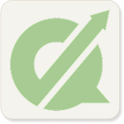

  
  <h1>Qurve</h1>
  
내 수준에서 시작하는 영어·일본어 학습 앱

## 프로젝트 소개

Qurve는 레벨 테스트로 현재 수준을 확인하고, 목표에 맞는 학습을 이어가는 모바일 앱입니다. 시험 대비(JLPT·TOEIC)와 실생활 과정 중 원하는 목표를 선택하고, 문제 풀이부터 오답 복습과 학습 기록 확인까지 한곳에서 할 수 있습니다.

## 핵심 기능

| 기능         | 할 수 있는 일                                                                      |
| ------------ | ---------------------------------------------------------------------------------- |
| 맞춤 학습    | 레벨 테스트로 수준을 진단하고, 선택한 언어와 목표에 맞는 문제와 단어를 학습합니다. |
| 오답 복습    | 틀린 문제 중 북마크한 항목을 날짜별로 찾아 정답과 해설을 다시 확인합니다.          |
| 학습 분석    | 학습 시간, 정답률, 출석 기록을 확인하고 챌린지에 참여합니다.                       |
| AI 학습 코치 | 현재 학습 중인 언어의 단어나 표현을 질문하고 설명을 받습니다.                      |

## 기술 스택

| 구분             | 기술                                                                                                                                                                                                                                                                                                                                                                                                                                                                           |
| ---------------- | ------------------------------------------------------------------------------------------------------------------------------------------------------------------------------------------------------------------------------------------------------------------------------------------------------------------------------------------------------------------------------------------------------------------------------------------------------------------------------ |
| 앱 개발          |                                                                                                                             |
| 화면 구성        |                                                                                                                                                                  |
| API·인증         |     |
| 테스트·코드 품질 |                                                                                                                                                                |
| 빌드·자동화      |                                                                                                                                                                                                                                               |
